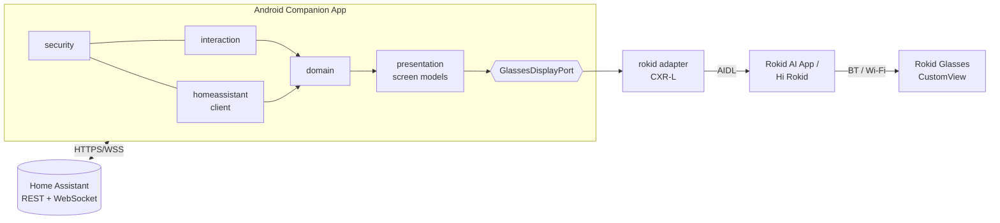
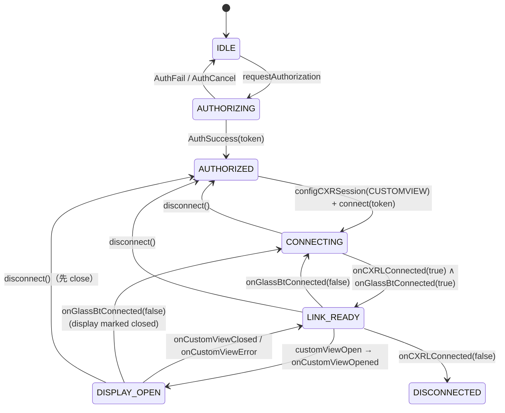

# 架構設計

> 狀態：P0。只有 `:domain`、`:rokid`、`:app`（P0 驗證 App）已實作。
> 其餘模組是**設計**，在 CustomView 通過實機驗證之前不實作。

## 1. 原則

1. **Home Assistant 是自動化引擎。** 不把 HA automation 搬進 Android。Android 只是橋接層與呈現層。
2. **Rokid SDK 隔離。** 只有 `:rokid` 模組可以 import `com.rokid.*`。HA、互動、呈現邏輯只依賴 `:domain` 定義的介面。
3. **以驗證為準。** 任何 UI 元件、輸入方式、SDK 行為，必須先在 SDK_COMPATIBILITY.md 標記為 VERIFIED（或至少 DOCUMENTED 且有明確風險註記）才能成為產品功能的依賴。
4. **安全預設拒絕。** 實體與服務採白名單；安全相關操作一律需要明確確認；AI 只能產生結構化意圖，不能直接執行。
5. **斷線不重播。** 重連後只重新訂閱與同步狀態，絕不自動重送未完成的控制命令。

## 2. 系統脈絡



## 3. 模組與依賴規則

| 模組 | 型態 | 內容 | 可依賴 | 狀態 |
| --- | --- | --- | --- | --- |
| `:domain` | Kotlin/JVM | 純模型與 port 介面：`GlassesDisplayPort`、`GlassesLinkState`、`DisplayScreen`、`GlassesDeviceInfo`；之後加入 Entity、Command、Notification 模型 | coroutines | ✅ P0 |
| `:rokid` | Android library | Rokid adapter：授權、Session、連線狀態、CustomView JSON 建構/驗證、`DisplayScreen → CustomView` 渲染、（P5）眼鏡端事件 | `:domain`、`client-l` | ✅ P0 |
| `:app` | Android app | P0：驗證 App。之後：Compose 手機 UI、DI 組裝、前景服務 | 全部 | ✅ P0（驗證用） |
| `homeassistant/` | Kotlin（JVM） | REST、WebSocket、認證、訂閱、重連、實體快取 | `:domain`、OkHttp | 設計（P2） |
| `data/` | Android library | 設定、白名單、Keystore 加密儲存 | `:domain` | 設計（P2） |
| `presentation/` | Kotlin（JVM） | 五個眼鏡畫面的畫面模型：`dashboard/`、`quick_control/`、`device_detail/`、`notifications/`（+ 確認對話框） | `:domain` | 設計（P1） |
| `interaction/` | Kotlin（JVM）+ adapter | 輸入事件標準化、導航、選取、確認、逾時、去抖動：`phone/`、`buttons/`、`touch/`、`imu/` | `:domain` | 設計（P1/P5/P6） |
| `security/` | Kotlin（JVM） | 實體白名單、服務白名單、確認政策、AI 意圖驗證 | `:domain` | 設計（P2/P3） |

依賴方向（不可反向）：

```
app ─▶ rokid ─▶ domain ◀─ homeassistant
 │                ▲  ▲
 └────────────────┘  └─ presentation, interaction, security, data
```

`homeassistant` 與 `presentation` **絕不能**看到 `com.rokid.*`；`rokid` 不知道 Home Assistant 存在。
目前資料夾 `data/`、`homeassistant/` 等只放 README（設計說明），實作時才轉成 Gradle 模組。

## 4. Rokid Adapter（已實作）

`RokidGlassesLink`（`rokid/src/main/java/tw/rokidha/rokid/link/`）實作 `GlassesDisplayPort`。

### 4.1 狀態機

依官方「開發流程與狀態機」章節對應為 `GlassesLinkState.Stage`：



### 4.2 設計決策

| 決策 | 理由 |
| --- | --- |
| 進程單例（`Application` 持有） | 官方要求一個進程一個 `CXRLink`、`setCXRLinkCbk` 只註冊一次 |
| 回呼在 `connect()` 前註冊 | SDK 在服務連上時直接解參考回呼，未設定會 crash（SDK_RESEARCH.md §8-1） |
| 方法回傳 `Boolean` = 「請求已送出」，真正結果走 `StateFlow` | 與 SDK 回呼模型一致，避免把 `true` 誤當成功 |
| 送出前用 `CustomViewValidator` 驗證 | 眼鏡端對錯誤 JSON 的行為未記載；寧可在手機端拒絕 |
| 只用 1.0.3/1.0.4 共有 API | 可切換版本交叉比對；1.0.4 新 API 未經文件或實機確認 |
| 攔截 `UnsatisfiedLinkError` | x86 裝置/模擬器沒有 Rokid 原生函式庫 |
| Token 只放記憶體，log 只記 `tokenPresent` | 未知的 token 生命週期與敏感性；SDK 本身會把 token 寫入 logcat，我們不再擴大 |
| 眼鏡 SN 在 log/報告中遮蔽 | 裝置識別資訊 |
| `disconnect()` 自行重設狀態 | `unbindService` 不會觸發 SDK 的斷線回呼 |

### 4.3 執行緒

SDK 回呼來自 binder 執行緒；所有狀態以 `MutableStateFlow.update` 原子更新。公開方法預期由主執行緒呼叫。UI 以 `collectAsStateWithLifecycle` 讀取。

## 5. 後續模組設計（未實作）

### 5.1 Home Assistant Client（P2）

- REST：`/api/`、`/api/states`、`/api/states/{entity_id}`、`/api/services/{domain}/{service}`。
- WebSocket `/api/websocket`：`auth` → `get_states`（初始快取）→ `subscribe_events(state_changed)` 或 `subscribe_entities`（只訂閱白名單實體）→ `call_service`。
- 重連：指數退避 + 抖動；重連成功後**重新認證、重新 `get_states`、重新訂閱**。
- **未完成的命令不重送**：命令有 `id` 與逾時；斷線時一律標記為「結果未知」，UI 顯示讓使用者自行決定是否重試。
- 本地實體快取：`Map<entityId, EntityState>`，`unavailable` / `unknown` 是一級狀態，畫面上明確顯示。
- 只依賴 `:domain`；用 OkHttp WebSocket。HTTPS/WSS 強制（只允許使用者明確設定的本地網段例外，預設關閉）。

### 5.2 Display Renderer / Presentation（P1）

- 五個畫面（Home Dashboard、Quick Control、Device Detail、Notification、Confirmation）各自是純 Kotlin 的畫面模型 → `DisplayScreen`。
- 第一次顯示用 `show()`（`customViewOpen`），之後同畫面內只用 `updateText()`（`customViewUpdate`）做增量更新；換畫面才 close + open。
- 更新節流：同一行合併，最多每 N 毫秒送一次（N 依 V-12b 實測結果決定）。
- 選取游標以文字前綴呈現（例如 `▶`），因為 CustomView 沒有焦點/點擊能力。

### 5.3 Interaction Engine（P1 手機、P5 眼鏡端、P6 IMU）

- 所有輸入來源轉成同一組語意事件：`Next`、`Previous`、`Select`、`Back`、`Confirm`、`Cancel`。
- Phase 1：手機觸控（主要輸入）。
- Phase 2（P5）：CustomView **沒有輸入回呼**；眼鏡按鍵/觸控板只有在 CustomApp（眼鏡端 APK + CXR-S）的系統有序廣播可取得，再經自訂指令傳回手機。這代表顯示也可能要從 CustomView 改為 CustomApp，屆時重新評估。
- Phase 3（P6）：IMU 沒有任何 SDK API，需先在眼鏡端 App 實測 Android `SensorManager`。
- 防誤觸：去抖動、手勢門檻、互動逾時、模式鎖定、危險操作二次確認。

### 5.4 Notification Manager（P4）

- 來源：HA 事件（自訂 event 或特定實體狀態變化），由 HA 端 automation 決定是否通知；Android 不自行判斷自動化。
- 三級優先：HIGH（門開、漏水、警報、設備故障）、MEDIUM（洗碗機/洗衣機完成、溫度異常）、LOW（一般狀態）。
- HIGH 立即搶佔顯示；MEDIUM 排隊；LOW 不主動佔用眼鏡顯示，只在 Dashboard 摘要出現。
- 佇列、去重、過期、手動關閉；通知上的動作只能是白名單內的 script/scene。

### 5.5 Security（P2/P3）

- 專用 HA 使用者帳號 + Long-Lived Access Token，以 Android Keystore 支援的加密儲存（AES-GCM，金鑰不可匯出）。
- 憑證絕不送往眼鏡、不寫入 log。
- 實體白名單（預設空，使用者挑選）+ 服務白名單（`domain.service` 粒度）。
- 確認政策：`lock.*`、`alarm_control_panel.*`、`cover.*`、標記為敏感的 script/scene 一律需要確認畫面。
- AI（P6）只能輸出 `{"intent": ..., "entity_id": ..., ...}`，經白名單 + schema 驗證後轉成命令，仍走同一個確認政策。

## 6. 開發里程碑對應

| 里程碑 | 交付 | 進入條件 |
| --- | --- | --- |
| **P0** | SDK 研究、相容性文件、最小 App、建置成功、實機清單 | — |
| P1 | Home Dashboard 靜態顯示、增量更新、畫面模型 | P0 #2–#10 VERIFIED |
| P2 | HA REST/WebSocket、認證、狀態同步、Keystore | P1 |
| P3 | 燈、冷氣、script、scene 控制 + 確認 | P2 |
| P4 | 通知、優先級、動作、關閉 | P3 |
| P5 | CXR-S、CustomApp、按鍵/觸控、雙向訊息 | CXR-L 相容性確立 + 取得眼鏡端 ADB/開發線 |
| P6 | IMU、AI、相機 | P5 |

## 7. 工具鏈選擇

刻意選擇成熟且互相相容的版本，不追最新：

| 元件 | 版本 | 理由 |
| --- | --- | --- |
| Gradle | 8.14.3 | AGP 8.7 支援；8.x 最後的穩定線 |
| AGP | 8.7.3 | 成熟的 8.x；官方範例用 AGP 9.2.1（內建 Kotlin、DSL 變更較大），我們不需要 9.x 的功能 |
| Kotlin | 2.0.21 | K2 穩定版；`client-l` 只要求 stdlib ≥ 1.6.0 |
| compileSdk / targetSdk | 35 | 官方範例用 36.1；35 已足夠，降低工具鏈需求 |
| minSdk | 31 | 官方文件要求 |
| JVM target | 17 | 可在 JDK 17 或更新版本建置 |
| Compose BOM | 2024.12.01 | 與 Kotlin 2.0.21 compose compiler 相容 |
| coroutines | 1.9.0 | 與 client-l 1.1.x 未來可能的依賴一致 |

未來若需升級到 AGP 9 / compileSdk 36，再對照官方範例工程設定進行。
