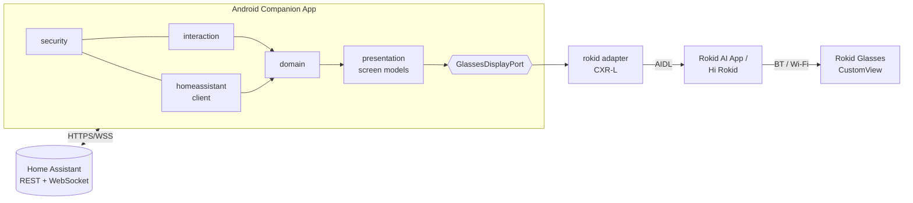
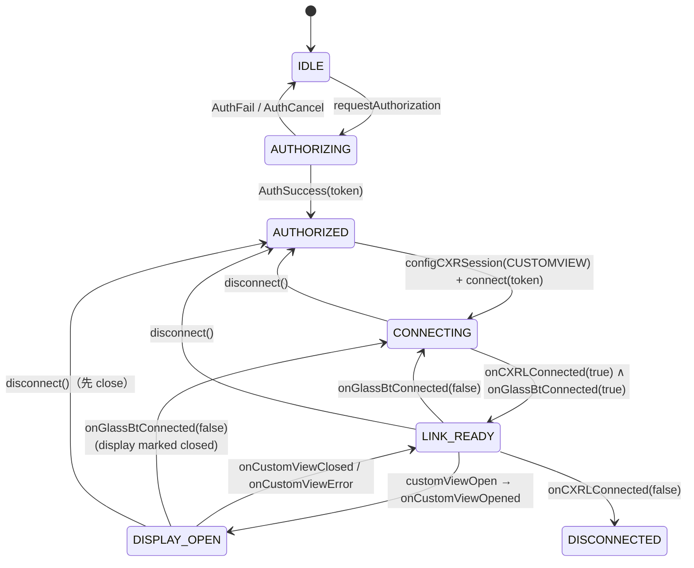
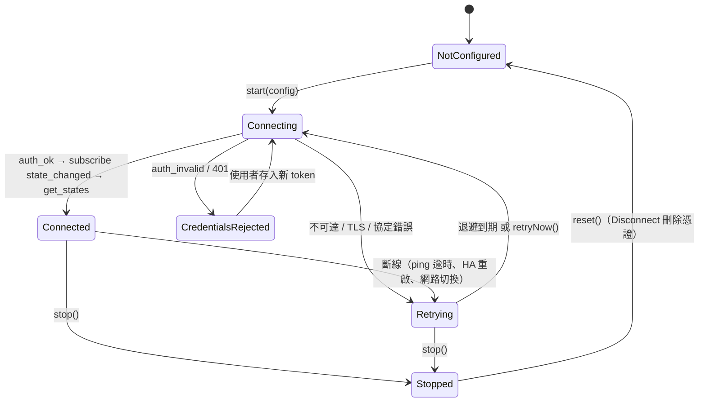

# 架構設計

> 狀態：P0。只有 `:domain`、`:rokid`、`:app`（P0 驗證 App）已實作。
> 其餘模組是**設計**，在 CustomView 通過實機驗證之前不實作。

## 1. 原則

1. **Home Assistant 是自動化引擎。** 不把 HA automation 搬進 Android。Android 只是橋接層與呈現層。
2. **Rokid SDK 隔離。** 只有 `:rokid`（手機端）與 `:glassesapp`（眼鏡端）可以 import `com.rokid.*`。HA、互動、呈現邏輯只依賴 `:domain` 定義的介面。
3. **以驗證為準。** 任何 UI 元件、輸入方式、SDK 行為，必須先在 SDK_COMPATIBILITY.md 標記為 VERIFIED（或至少 DOCUMENTED 且有明確風險註記）才能成為產品功能的依賴。
4. **安全預設拒絕。** 實體與服務採白名單；安全相關操作一律需要明確確認；AI 只能產生結構化意圖，不能直接執行。
5. **斷線不重播。** 重連後只重新訂閱與同步狀態，絕不自動重送未完成的控制命令。

## 2. 系統脈絡



## 3. 模組與依賴規則

| 模組 | 型態 | 內容 | 可依賴 |
| --- | --- | --- | --- |
| `:domain` | Kotlin/JVM | 眼鏡 port：`GlassesDisplayPort`、`GlassesLinkState`、`DisplayScreen`、`GlassesDeviceInfo` | coroutines |
| `:homeassistant` | Kotlin/JVM | URL 政策（`HaServerUrl`）、`AccessToken`、REST（`HaRestClient`）、WebSocket（`HaWebSocketConnector`/`HaWsSession`）、`HaConnectionManager`（重連/退避/快取）、`HaConnectionTester`、mDNS TXT 解析、`CredentialStore` 邏輯、`GlassesSelection`/`ServiceCatalog`/`ServiceCallGuard`、`HaNotification` | OkHttp、kotlinx-serialization、coroutines |
| `:presentation` | Kotlin/JVM | Glasses UI Bridge（`GlassesDashboardBridge`）、`DashboardRenderer`、`EntityFormatter`、`NotificationCenter`（優先級） | `:domain`、`:homeassistant` |
| `:data` | Android library | `KeystoreSecretCipher`（Android Keystore AES-GCM）、`SharedPrefsKeyValueStore`、`NsdHaDiscovery`（NsdManager） | `:homeassistant` |
| `:rokid` | Android library | Rokid CXR-L adapter：授權、Session、CustomView JSON、`RokidGlassesLink implements GlassesDisplayPort` | `:domain`、`client-l` |
| `:glassesproto` | Kotlin/JVM | 手機 ↔ 眼鏡 App 訊息格式（版本、大小限制、只允許 NEXT/PREVIOUS/SELECT/BACK）、按鍵對應 | `:domain` |
| `:glassesapp` | Android app（眼鏡端） | CXR-S：顯示手機送來的文字畫面、回報鏡腿按鍵 / 觸控板；無 INTERNET、無憑證；以 asset 打包進手機 App | `:glassesproto`、`cxr-service-bridge` |
| `:app` | Android app | 設定 / 實體 / 眼鏡三個畫面、`AppContainer` 組裝、`HaConnectionService` 前景服務、P0 診斷 | 全部 |

依賴方向（不可反向）：

```
app ─▶ data ─▶ homeassistant ◀─ presentation ─▶ domain ◀─ rokid
 └──────────────────────────────────┴───────────────────────┘
```

- `homeassistant`、`presentation` **看不到** `com.rokid.*` 與 Android；`rokid` 不知道 Home Assistant 存在。
- 憑證（URL、token）只存在於 `homeassistant`（`HaConfig`）、`data`（加密儲存）與 `app` 的設定畫面。
  `GlassesDashboardBridge` 的輸入只有實體狀態、連線狀態與通知 —— **型別上就拿不到 token**，並有端到端測試確認眼鏡收到的文字不含 token 與伺服器位址。
- `interaction/`、`security/` 目前只有 README：互動（P5/P6）尚未實作；安全規則已實作於 `homeassistant/selection` 與 `credentials`。

## 4. Rokid Adapter（已實作）

`RokidGlassesLink`（`rokid/src/main/java/tw/rokidha/rokid/link/`）實作 `GlassesDisplayPort`。

### 4.1 狀態機

依官方「開發流程與狀態機」章節對應為 `GlassesLinkState.Stage`：



### 4.2 設計決策

| 決策 | 理由 |
| --- | --- |
| 進程單例（`Application` 持有） | 官方要求一個進程一個 `CXRLink`、`setCXRLinkCbk` 只註冊一次 |
| 回呼在 `connect()` 前註冊 | SDK 在服務連上時直接解參考回呼，未設定會 crash（SDK_RESEARCH.md §8-1） |
| 方法回傳 `Boolean` = 「請求已送出」，真正結果走 `StateFlow` | 與 SDK 回呼模型一致，避免把 `true` 誤當成功 |
| 送出前用 `CustomViewValidator` 驗證 | 眼鏡端對錯誤 JSON 的行為未記載；寧可在手機端拒絕 |
| 只用 1.0.3/1.0.4 共有 API | 可切換版本交叉比對；1.0.4 新 API 未經文件或實機確認 |
| 攔截 `UnsatisfiedLinkError` | x86 裝置/模擬器沒有 Rokid 原生函式庫 |
| Token 只放記憶體，log 只記 `tokenPresent` | 未知的 token 生命週期與敏感性；SDK 本身會把 token 寫入 logcat，我們不再擴大 |
| 眼鏡 SN 在 log/報告中遮蔽 | 裝置識別資訊 |
| `disconnect()` 自行重設狀態 | `unbindService` 不會觸發 SDK 的斷線回呼 |

### 4.3 執行緒

SDK 回呼來自 binder 執行緒；所有狀態以 `MutableStateFlow.update` 原子更新。公開方法預期由主執行緒呼叫。UI 以 `collectAsStateWithLifecycle` 讀取。

## 5. Home Assistant 整合（已實作）

### 5.1 設定流程（手機）

`發現（mDNS）或手動輸入 URL → 貼上 Long-Lived Access Token → Test（REST /api/ + /api/config + WS auth）→ Save（Keystore 加密）→ 連線`。
眼鏡端完全不需要輸入任何東西。

### 5.2 HaConnectionManager



- 先 `subscribe_events(state_changed)` 再 `get_states`，避免兩者之間的變化遺失。
- 非管理員使用者只能訂閱 allowlist 內的事件（`state_changed` 可以，自訂事件不行），所以 HA 通知改經由 helper 實體 `input_text.rokid_ha_notification` 傳遞。
- 區域（area）以 registry 指令盡力取得；失敗時以 domain 分組。
- **命令不排隊、不重播**：離線時 `callService` 立即失敗；進行中的命令遇到斷線回報 `ConnectionLost`（結果未知）。

### 5.3 Glasses UI Bridge

- 眼鏡鏈路就緒（`linkReady`）且 autoShow 開啟 → 自動 `show(dashboard)`。
- 之後只送出有變化的行（`updateText` → `customViewUpdate`），最小間隔 500 ms。
- favorites 改變 → `hide()`，收到關閉後以新版面重開。
- HA 離線：狀態行 `HA OFFLINE · reconnecting`、數值加 `~` 前綴、頁尾 `Not live · last data …`；未設定 / 已登出 / token 被拒：數值隱藏。
- 通知：HIGH 立即顯示 15 分鐘、MEDIUM 5 分鐘、LOW 只在手機顯示。

### 5.4 互動（眼鏡 → 手機 → HA）

所有命令（手機按鈕、眼鏡輸入、未來 AI）都經過同一個 `ActionDispatcher`：allowlist → HA 已連線 → 實體存在且可用 → 同實體無進行中命令 → `call_service` → 等待確認的 `state_changed`。
眼鏡輸入（`GlassesInput`，僅 PRIMARY/NEXT/PREVIOUS/SELECT/BACK，不含實體或服務）由 `GlassesInteractionController` 處理：`InputGate` 去重 / 去抖 / 丟棄過期事件，兩段式確認，HA 或眼鏡斷線即解除 armed。
CXR-L 的 AI 鍵路線首次實機測試失敗；主要路線改為 CXR-S 眼鏡端 App（`RokidGlassesLink` 的 CUSTOM_APP 模式，與 CustomView 二選一），尚未實機驗證。詳見 [GLASSES_CONTROL.md](GLASSES_CONTROL.md)。

### 5.5 安全

見 README「Security considerations」。重點：Keystore AES-256-GCM、禁止備份、token 不記錄不顯示、`AccessToken.toString()` 遮蔽、
不跟隨 redirect、遠端強制 https 且不降級、設定頁 `FLAG_SECURE`、Disconnect 連同金鑰刪除。
HA 本身沒有逐實體權限，allowlist 保護的是本 App 的行為，不是 token 外洩後的風險。

### 5.6 背景執行與 QR 配對

見 [BACKGROUND_OPERATION.md](BACKGROUND_OPERATION.md) 與 [QR_PAIRING.md](QR_PAIRING.md)（僅設計）。

## 6. 開發里程碑對應（原始 P0–P6 規劃）

> 2026-11-02：依使用者明確要求，在眼鏡實機驗證完成前即實作 Home Assistant 手機端整合與 Dashboard 同步。
> 所有依賴眼鏡的功能仍標記為 DOCUMENTED / UNKNOWN，直到實機驗證。

| 里程碑 | 交付 | 進入條件 |
| --- | --- | --- |
| **P0** | SDK 研究、相容性文件、最小 App、建置成功、實機清單 | — |
| P1 | Home Dashboard 靜態顯示、增量更新、畫面模型 | P0 #2–#10 VERIFIED |
| P2 | HA REST/WebSocket、認證、狀態同步、Keystore | P1 |
| P3 | 燈、冷氣、script、scene 控制 + 確認 | P2 |
| P4 | 通知、優先級、動作、關閉 | P3 |
| P5 | CXR-S、CustomApp、按鍵/觸控、雙向訊息 | CXR-L 相容性確立 + 取得眼鏡端 ADB/開發線 |
| P6 | IMU、AI、相機 | P5 |

## 7. 工具鏈選擇

刻意選擇成熟且互相相容的版本，不追最新：

| 元件 | 版本 | 理由 |
| --- | --- | --- |
| Gradle | 8.14.3 | AGP 8.7 支援；8.x 最後的穩定線 |
| AGP | 8.7.3 | 成熟的 8.x；官方範例用 AGP 9.2.1（內建 Kotlin、DSL 變更較大），我們不需要 9.x 的功能 |
| Kotlin | 2.0.21 | K2 穩定版；`client-l` 只要求 stdlib ≥ 1.6.0 |
| compileSdk / targetSdk | 35 | 官方範例用 36.1；35 已足夠，降低工具鏈需求 |
| minSdk | 31 | 官方文件要求 |
| JVM target | 17 | 可在 JDK 17 或更新版本建置 |
| Compose BOM | 2024.12.01 | 與 Kotlin 2.0.21 compose compiler 相容 |
| coroutines | 1.9.0 | 與 client-l 1.1.x 未來可能的依賴一致 |
| OkHttp / MockWebServer | 4.12.0 | 成熟穩定版；REST + WebSocket；MockWebServer 支援 WebSocket 測試 |
| kotlinx-serialization-json | 1.7.3 | 與 Kotlin 2.0.21 相容；只用 JsonElement API，不需編譯器 plugin |

未來若需升級到 AGP 9 / compileSdk 36，再對照官方範例工程設定進行。
