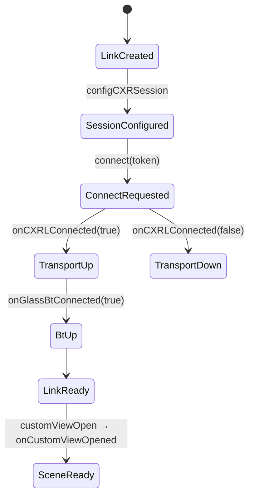

# Rokid SDK 研究報告（P0）

> 研究日期：2026-11-02
> 目標設備：Rokid Glasses Founder Edition（Glasses_0651，YODAOS-SPRITE，韌體 1.27.009-20261014-150203）
> 範圍：CXR-L（手機端，主要）、CXR-S（眼鏡端，僅研究）、CXR-M（僅授權與差異）
>
> **本文件只記錄「文件 / 範例 / 二進位」層級的事實，沒有任何一項已在目標實機驗證。**
> 實機結果一律寫在 [`SDK_COMPATIBILITY.md`](SDK_COMPATIBILITY.md)。

## 0. 證據等級

每條結論都標註來源，避免把推測當事實：

| 標記 | 意義 |
| --- | --- |
| **[DOC]** | Rokid 官方文件（CXR-L 文件包 v1.0.4，見 §11） |
| **[SAMPLE]** | Rokid 官方範例工程（RenewCXRLSample v1.0.4 / CXRSWithCXRLSample） |
| **[BIN]** | 直接檢查 Maven 上的 AAR：`javap` 方法簽章 + CFR 反編譯（不是官方說明，代表「目前二進位的實際行為」） |
| **[MAVEN]** | maven.rokid.com 上的 metadata / POM / Gradle module 檔 |
| **[COMM]** | 社群文件或範例，未經官方背書 |

---

## 1. SDK 架構總覽

```
 ┌──────────────── 手機 (Android) ────────────────┐        ┌──── 眼鏡 (YodaOS-Sprite) ────┐
 │                                                │        │                              │
 │  本專案 App ── CXR-L (client-l)                │        │  CustomView 渲染器（系統內建）│
 │                    │  AIDL bindService         │  BT /  │                              │
 │                    ▼                           │ Wi-Fi  │  CustomApp（自製 APK）        │
 │  Rokid AI App (com.rokid.sprite.aiapp)  ───────┼────────┼──   └─ CXR-S                 │
 │   或 Hi Rokid (com.rokid.sprite.global.aiapp)  │        │       (cxr-service-bridge)   │
 └────────────────────────────────────────────────┘        └──────────────────────────────┘
```

- **CXR-L 不直接連眼鏡。** 它透過 AIDL bind 到 Rokid AI App 的服務
  `com.rokid.sprite.aiapp.externalapp.MEDIA_STREAM_SERVICE`，由 Rokid AI App 負責與眼鏡的藍牙/Wi-Fi 連線。[DOC][BIN]
- 所以 Rokid AI App（大陸）或 Hi Rokid（海外）**必須安裝、登入、且已與眼鏡配對**。[DOC]
- 官方開發者入口 `open.rokid.com/sprite` 對 YodaOS-Sprite 只列出 **CXR-L** 與 **CXR-S** 兩套 SDK。[DOC]

### 各 SDK 的責任

| SDK | Maven 座標 | 執行位置 | 責任 | 本專案用途 |
| --- | --- | --- | --- | --- |
| **CXR-L** | `com.rokid.cxr:client-l` | 手機 App | 授權、會話、CustomView 下發、CustomApp 遠端安裝/啟動、音訊、拍照、自訂指令、亮度/音量 [DOC] | **P0–P4 唯一依賴** |
| **CXR-S** | `com.rokid.cxr:cxr-service-bridge` | 眼鏡端 Android App | CustomApp 業務邏輯，以 `Caps` 與手機雙向通訊，接收按鍵/觸控系統廣播 [DOC] | P5 研究，**目前不開發** |
| **CXR-M** | `com.rokid.cxr:client-m` | 手機 App | 直接用藍牙/Wi-Fi 連眼鏡（不經 Rokid AI App）的另一套手機端 SDK [COMM][MAVEN] | 不使用（見 §9） |

注意：官方文件明確說 **手機 App 不要引入 `cxr-service-bridge`**。[DOC]
但 `client-l` 本身的 POM 就以 `compile` scope 依賴 `cxr-service-bridge`（`Caps` 類別與原生函式庫來自它）。[MAVEN]
這是 SDK 內部的傳遞依賴，我們**不直接宣告**它。

---

## 2. Maven Repository 與版本

Repository：`https://maven.rokid.com/repository/maven-public/`（Sonatype Nexus 3.87.1；group 內含 release 與 snapshot）。[MAVEN]
`com.rokid.cxr` group 下有：`client`、`client-l`、`client-m`、`cxr-service-bridge`。[MAVEN]

### client-l 版本（maven-metadata.xml，lastUpdated 2026-09-10）

`0.0.1, 0.0.2, 0.3.0, 1.0.0, 1.0.1, 1.0.2, 1.0.3, 1.0.4, 1.1.0, 1.1.1, 1.1.2`
（另有 `*-SNAPSHOT`）；metadata 的 `<release>` = **1.1.2**。

### 1.0.3 vs 1.0.4

| 項目 | 1.0.3 | 1.0.4 |
| --- | --- | --- |
| 正式 Maven artifact | ✅ 存在（AAR 65,494 bytes） | ✅ **存在**（AAR 70,543 bytes） |
| SDK 內建版本字串 [BIN] | `CXRL SDK ver: 1.0.3, Time: 2026-06-01 19:28:34` | `CXRL SDK ver: 1.0.4, Time: 2026-06-18 15:50:05` |
| sources jar | ❌ 404 | ❌ 404 |
| 依賴 [MAVEN] | `cxr-service-bridge:1.0-20260522.063600-105`、`kotlin-stdlib:1.6.0`、`gson:2.10.1` | **完全相同** |
| AAR manifest | minSdk 28, **targetSdk 28** | minSdk 28（移除 targetSdk） |
| 官方文件版本 | 文件 v1.0.3 首次加入 CustomView JSON Schema | **目前官方文件版本 = 1.0.4** |
| Rokid AI App 最低版本 | ≥ 1.9.0（`versionCode ≥ 10090000`）[DOC][BIN] | 同左 |

**API 差異（javap 比對，1.0.4 相對 1.0.3 純新增，無刪除、無簽章改變）：** [BIN]

- `ICXRSessionCbk`（`onSessionAvailable/Start/Pause/Unavailable(CXRSessionReason)`）
- `CxrDefs.CXRSessionReason`、`CxrDefs.CXRSessionState`
- `configCXRSession(CXRSession, ICXRSessionCbk)`、`getCXRSessionState()`
- `setGlassBrightness(Int)`、`setGlassVolume(Int)`（範圍 0…15 [DOC]）
- `GlassInfo.screenOn`

文件與二進位不一致處：版本歷史說 1.0.4「`GlassInfo` 增加 `brightness` / `sound`」，但這兩個欄位**在 1.0.3 二進位就已存在**。[DOC] vs [BIN]
另外 `ICXRSessionCbk` / `configCXRSession(session, cbk)` 存在於 1.0.4 二進位，但 **官方 1.0.4 文件沒有提及**，因此視為 EXPERIMENTAL。

**結論：** 1.0.4 是正式發佈、向下相容 1.0.3 的超集合，且是官方文件與範例目前對應的版本。
本專案預設使用 **1.0.4**，P0 主要路徑只用兩版共有的 API，並可用 `-Prokid.cxrl.version=1.0.3` 切換（兩版皆已編譯並通過單元測試，見 SDK_COMPATIBILITY.md §2）。

### 1.1.x（觀察，不採用）

`1.1.2` 依賴 `kotlinx-coroutines-android:1.9.0`、`kotlin-stdlib:1.9.0` 與較新的 bridge snapshot `-107`，並新增一整套 `com.rokid.cxr.session.*` API（`CxrSessionManager`、`SessionConfig`、`SessionState`、`CapabilityBroker`…）。[BIN]
官方文件（2026-06-29 版）**沒有任何 1.1.x 的說明**。依「不得自行假設 API」原則，P0 不採用；待官方文件更新後再評估。

### Snapshot 依賴風險

`client-l` 1.0.3/1.0.4 依賴 **timestamped snapshot** `cxr-service-bridge:1.0-20260522.063600-105`。
檔案實際位於 `.../cxr-service-bridge/1.0-SNAPSHOT/cxr-service-bridge-1.0-20260522.063600-105.aar`，Gradle 能正確解析（已驗證，見 SDK_COMPATIBILITY.md）。[MAVEN]
**風險：** 若 Rokid 的 Nexus 執行 snapshot 清理策略，這個 timestamp 檔案可能被刪除，屆時全新環境將無法建置。緩解方式見 §10 R-3。

---

## 3. 官方支援能力（CXR-L 1.0.4）

| 能力 | 前置條件 [DOC] |
| --- | --- |
| 眼鏡端自訂 View（CustomView） | CUSTOMVIEW 會話 + 鏈路就緒 |
| 眼鏡端自訂應用（CustomApp） | CUSTOMAPP 會話 + 目標 APK（需整合 CXR-S） |
| 自訂指令（雙向 `Caps`） | **僅 CustomApp**，且眼鏡端 App 已開啟 |
| 音訊（PCM 串流） | 會話建構完成（CustomView 已開或 CustomApp 已啟動）+ `GlassPermission.MICROPHONE` |
| 拍照（JPEG） | 同上 + `GlassPermission.CAMERA` |
| 亮度/音量 0…15（1.0.4） | 鏈路就緒即可 |

官方能力矩陣 [DOC]：

| 會話 / 狀態 | 音訊 | 拍照 | 自訂指令 | 亮度 | 音量 |
| --- | --- | --- | --- | --- | --- |
| 未授權 / 無 token | 否 | 否 | 否 | 否 | 否 |
| 已授權但未 connect | 否 | 否 | 否 | 否 | 否 |
| 已 connect 但未完成會話建構 | 否 | 否 | 否 | 是 | 是 |
| CUSTOMVIEW 且 View 已開啟 | 是 | 是 | 否 | 是 | 是 |
| CUSTOMAPP 且眼鏡 App 已開啟 | 是 | 是 | 是 | 是 | 是 |

**關鍵限制：CustomView 沒有任何輸入回呼。** `ICustomViewCbk` 只有 opened/updated/closed/iconsSent/error。[DOC][BIN]
眼鏡端按鍵、觸控板事件**只能在 CustomApp（眼鏡端 APK + CXR-S）中取得**。[DOC]
→ Phase 1 的互動必須在手機上完成；眼鏡端互動要等 P5。

---

## 4. API 清單（CXR-L 1.0.4）

入口：`com.rokid.cxr.link.CXRLink(context)`，繼承 `com.rokid.sprite.aiapp.externalapp.example.ExternalAppClient`。[DOC][BIN]

### 4.1 授權 `com.rokid.sprite.aiapp.externalapp.auth.AuthorizationHelper`（Kotlin `object`）

| API | 說明 |
| --- | --- |
| `isRequiredRokidAppInstalled(Activity): Boolean` | Rokid AI App 已安裝且 versionCode ≥ 10090000 [DOC][BIN] |
| `isRequiredHiRokidInstalled(Activity): Boolean` | Hi Rokid 已安裝且 versionCode ≥ 10090000 [DOC][BIN] |
| `isConnectHiRokid(): Boolean` | 是否走海外 Hi Rokid 服務（決定 bind 哪個 package）[DOC][BIN] |
| `requestAuthorization(Activity, Array<GlassPermission>? = null, requestCode: Int): Pair<Int, Intent>?` | 開啟授權 UI；**若已授權可能同步回傳結果**，需立即解析 [DOC] |
| `parseAuthorizationResult(resultCode: Int, data: Intent?): AuthResult` | 第一個參數是 **resultCode** 不是 requestCode [DOC] |
| `hasGlassPermission(GlassPermission): Boolean` | 查詢已授予的眼鏡端權限 |
| `AuthResult.AuthSuccess(token)` / `AuthFail` / `AuthCancel` | 結果型別 |
| `GlassPermission.MICROPHONE / CAMERA / MEDIA` | 眼鏡端權限 [BIN]（文件只列 MICROPHONE、CAMERA） |

### 4.2 連線與會話（`CXRLink`）

| API | 說明 |
| --- | --- |
| `configCXRSession(CxrDefs.CXRSession(type[, pkg])): Boolean` | **必須在 `connect` 之前**；type = `CUSTOMVIEW` / `CUSTOMAPP` [DOC] |
| `setCXRLinkCbk(ICXRLinkCbk)` | 進程內只註冊一次 [DOC] |
| `connect(token: String): Boolean` | `true` 只代表 **bind 請求已送出**；結果以回呼為準 [DOC] |
| `disconnect()` | `unbindService`，並把會話類型重設為 NONE [BIN] |
| `isGlassBtConnected(): Boolean` | 同步查詢眼鏡藍牙狀態 [BIN][COMM] |
| `getGlassDeviceInfo()` | 結果經 `onGlassDeviceInfo(GlassInfo)` 回傳 [DOC] |
| `getServiceVersion() / getServiceVersionCode()` | Rokid AI App 服務版本 [BIN] |

`ICXRLinkCbk` [DOC]：`onCXRLConnected(Boolean)`、`onGlassBtConnected(Boolean)`、`onGlassDeviceInfo(GlassInfo)`、`onGlassWearingStatus(Boolean)`、`onGlassAiAssistStart()`、`onGlassAiAssistStop()`、`onGlassAiInterrupt(Boolean)`。

`GlassInfo` 欄位 [BIN]：`deviceName, batteryLevel, sound, brightness, systemVersion, ischarging, sn, wearingStatus, screenOn(1.0.4)`。

### 4.3 CustomView

| API | 說明 [DOC] |
| --- | --- |
| `setCXRCustomViewCbk(ICustomViewCbk)` | 註冊回呼 |
| `customViewSetIcons(json): Boolean` | 圖示陣列（Base64 PNG）；有 ImageView 時必須先送 |
| `customViewOpen(json): Boolean` | 完整視圖樹 |
| `customViewUpdate(json): Boolean` | 增量更新陣列 |
| `customViewClose(): Boolean` | 關閉 |
| `customViewIsOpen(): Boolean` | 查詢 |
| `customViewGetCurrentData() / customViewGetCurrentIcons(): String` | 讀回目前資料 [BIN，文件未提] |

`ICustomViewCbk`：`onCustomViewOpened()`（= CustomView 會話建構完成）、`onCustomViewUpdated()`、`onCustomViewClosed()`、`onCustomViewIconsSent()`、`onCustomViewError(code, msg)`（應清除「已開啟」狀態）。[DOC]

### 4.4 CustomApp / 自訂指令 / 媒體（P0 不使用，列出供後續參考）

`appUploadAndInstall(path, cbk)`、`appUninstall(cbk)`、`appStart(activity[, interruptAiWake], cbk)`、`appStop(cbk)`、`appIsInstalled(cbk)`、
`sendCustomCmd(cmd, Caps[, bytes]): Integer`、`setCXRCustomCmdCbk`、`startAudioStream(codec)`、`stopAudioStream()`、`setCXRAudioCbk`、
`takePhoto(w=1920, h=1080, quality=80)`、`setCXRImageCbk`、`sendExitAI(Boolean)`、`setInterruptAiWake(Boolean)`、`isWearingCheckOn()`。[DOC][BIN]

`sendCustomCmd` 的 cmd 名稱不可使用保留字：`Dev, Med, Ota, Ai, Ntf, Nav, Sys, ARTC, Trans, Pay, Settings, Custom_View, Schedule, Memo`。[BIN]

---

## 5. Session 工作模式與連線流程

### 5.1 官方流程（Android）[DOC]



- **鏈路就緒** = `onCXRLConnected(true)` **且** `onGlassBtConnected(true)`。未就緒時**不得**呼叫 `customViewSetIcons` / `customViewOpen`。[DOC]
- **鏈路就緒 ≠ 會話建構完成。** CustomView 的會話建構 = 收到 `onCustomViewOpened`。[DOC]
- 會話類型一經設定就鎖定；要切換類型必須重建 `CXRLink`。[DOC] 二進位上：第二次 `configCXRSession` 會回 `false`（"SessionType already set"），只有 `disconnect()` 或服務斷線才會重設。[BIN]
- 進程內只用一個 `CXRLink`；子頁面不得呼叫 `disconnect()`；會話真正結束時才 `customViewClose()`。[DOC]

### 5.2 CustomView 呼叫順序（本專案採用）

1. `AuthorizationHelper.isRequired*Installed` → `requestAuthorization` → `parseAuthorizationResult` 取得 token
2. `CXRLink(appContext)`
3. `configCXRSession(CXRSession(CUSTOMVIEW))`
4. `setCXRLinkCbk(...)`、`setCXRCustomViewCbk(...)` — **兩者都在 `connect` 之前**（見 §8 第 1 點）
5. `connect(token)`
6. 等待 `onCXRLConnected(true)` 與 `onGlassBtConnected(true)`
7. （若有 ImageView）`customViewSetIcons` → 等 `onCustomViewIconsSent`
8. `customViewOpen(json)` → 等 `onCustomViewOpened`
9. `customViewUpdate(json)`*（每次等 `onCustomViewUpdated`）
10. `customViewClose()` → `onCustomViewClosed`
11. `disconnect()`（只在整個會話結束時）

### 5.3 1.0.4 新增的 SessionState（EXPERIMENTAL）

`ICXRSessionCbk` 的觸發點（從 bytecode 讀出）[BIN]：

| 事件 | 觸發來源 |
| --- | --- |
| `onSessionAvailable(SESSION_LINK_CONNECT)` | AIDL 服務連上 |
| `onSessionStart(SESSION_GLASS_READY)` | `onCustomViewOpened` 或 `onOpenAppResult(true)` |
| `onSessionPause(SESSION_SCREEN_OFF)` | 眼鏡螢幕由亮轉暗（從 device info 推得） |
| `onSessionPause(SESSION_AI_START)` | 使用者按下 AI 鍵 |
| `onSessionUnavailable(SESSION_SCENE_TAKEOVER)` | 眼鏡進入系統場景：錄音、導航、通話、翻譯、拍照頁、OTA、直播等 |
| `onSessionUnavailable(SESSION_GLASS_IDLE)` | CustomView 關閉 / CustomApp 停止 |
| `onSessionUnavailable(SESSION_LINK_DISCONNECT)` | AIDL 服務斷線 |

這對「通知被系統場景蓋掉」很重要，但**官方文件未記載**，P0 不依賴它，列為 P1 實機研究項目。

---

## 6. CustomView JSON Schema（官方，v1.0.3 起）

完整定義見官方「眼鏡端自定義View」章節；摘要如下。[DOC]
本專案的 [`CustomViewValidator`](../rokid/src/main/java/tw/rokidha/rokid/customview/CustomViewValidator.kt) 依此實作，拒絕 schema 以外的 key。

- 節點：`{"type": String, "props": Object, "children": [節點...]}`；`children` 可省略。
- `type` 只有四種：`LinearLayout`、`RelativeLayout`、`TextView`、`ImageView`。
  **沒有 WebView、Button、ListView、HTML，也沒有點擊事件。**
- 所有 props 值都是**字串**（包含布林 `"true"`、尺寸 `"16dp"`）。
- 公共：`id`（必填，`[a-zA-Z0-9_]+`，全樹唯一）、`layout_width` / `layout_height`（必填，`match_parent` | `wrap_content` | `{N}dp`）、`margin*` / `padding*`（`{N}dp`）、`backgroundColor`（`#RRGGBB` / `#AARRGGBB`）。
- `LinearLayout`：`orientation`（**必填**，`vertical` | `horizontal`）、`gravity`、`layout_gravity`。
  文件註明 LinearLayout 的 `paddingStart/End` 在 JSON 中使用 `paddingLeft/paddingRight` 鍵名（官方範例的序列化器也是如此）。[DOC][SAMPLE]
- `RelativeLayout`：`layout_toStartOf/toEndOf/above/below/alignStart/alignEnd/alignTop/alignBottom/alignBaseLine`（值為其他節點 id）、
  `layout_aliginParentStart/End/Top/Bottom`（**協議鍵名就是 "aligin" 這個拼法**）、`layout_centerInParent/Horizontal/Vertical`（`"true"`/`"false"`）。
- `TextView`：`text`（必填）、`textColor`、`textSize`（`{N}sp`）、`gravity`、`textStyle`（`bold` | `italic` | `bold_italic`）。
- `ImageView`：`name`（必填，對應 `customViewSetIcons` 的 name）、`scaleType`（`center` | `center_crop` | `center_inside` | `fit_center` | `fit_end` | `fit_start` | `fit_xy` | `matrix`）。
- 圖示：`[{"name": "...", "data": "<Base64 PNG, NO_WRAP>"}]`
- 更新：`[{"action": "update", "id": "...", "props": {只放要改的欄位}}]`；`action` 只有 `"update"`。
- **顏色**：眼鏡為單綠色通道顯示，色值會被映射成綠色系，不能假設全彩。[DOC] 官方範例另有 `processColorValue()` 只保留綠色通道。[SAMPLE]
- 官方範例工程含 `LottieAnimProps`（Lottie 動畫節點），但 **schema 文件未列入**，CXR-L 也沒有對應的 Lottie API（CXR-M 有）。→ 視為不支援。[SAMPLE][BIN]

---

## 7. 權限需求

### 手機端 App（CustomView 路徑）

| 權限 | 必要性 [DOC] |
| --- | --- |
| `INTERNET` | **必需** |
| `MANAGE_MEDIA`、`MANAGE_EXTERNAL_STORAGE`、`READ_EXTERNAL_STORAGE(maxSdk 32)` | 僅 CustomApp 從公共目錄安裝 APK 時需要 → **P0 不申請** |

- `client-l` 的 manifest 會自動合併 `<queries>`（`com.rokid.sprite.aiapp`、`com.rokid.sprite.global.aiapp`），Android 11+ 的套件可見性因此滿足。[BIN] 已在 merged manifest 確認。
- 不需要藍牙或位置權限：藍牙由 Rokid AI App 負責。[DOC]
- 眼鏡端權限（MICROPHONE/CAMERA）在 `requestAuthorization` 時申請；**P0 不申請任何眼鏡端權限**（最小權限）。

### 系統需求

- Android **minSdk 31**（官方文件要求；AAR 本身宣告 28）。[DOC]
- Rokid AI App **≥ 1.9.0**（大陸）或 Hi Rokid（海外，最低版本檢查同為 versionCode ≥ 10090000）。[DOC][BIN]
- **ABI：只有 `arm64-v8a`、`armeabi-v7a`。** `CXRLink` 建構子會 `System.loadLibrary("cxr-sock-proto-jni")`；x86/x86_64 模擬器會丟 `UnsatisfiedLinkError`。[BIN] 本專案的 adapter 會攔截並回報錯誤，不會 crash。

---

## 8. 已知限制與 SDK 行為陷阱（從 bytecode 讀出，非官方說明）

1. **回呼必須在 `connect()` 之前註冊。** 服務連上時，SDK 直接呼叫 `cxrlCbk`（Kotlin `lateinit`，未設定會丟 `UninitializedPropertyAccessException`），
   而 CustomView 的 AIDL stub 對 `ICustomViewCbk` 使用 `checkNotNull`。官方範例是在 `connect` 後才設 CustomView 回呼，存在競態風險；本專案改在 `connect` 前設定（官方「連線與會話」章節的範例也是這個順序）。[BIN]
2. **`connect(token)` 會把 token 以 INFO 等級寫進 logcat**（`"connect by token: <token>"`）。[BIN] 一般 App 無法讀取他人 logcat，但接上 ADB 的電腦可以。→ 實機除錯時注意 logcat 外流。
3. `disconnect()` 使用 `unbindService`，**不會**觸發 `onServiceDisconnected`，所以 SDK 不會回呼斷線；呼叫端要自己重設狀態。[BIN]
4. `customViewClose()` 與 `customViewIsOpen()` **不檢查會話類型**；`customViewOpen/Update/SetIcons` 會檢查必須是 CUSTOMVIEW。[BIN]
5. `connect` 要 bind 哪個套件（大陸/海外）取決於 `AuthorizationHelper` 的內部靜態旗標 `isConnectHiRokid()`，由授權流程設定（該方法反編譯失敗，無法確認細節）。[BIN] → **授權與連線必須在同一個進程生命週期內完成**；App 被殺後要重新授權。
6. `AuthorizationHelper.hasGlassPermission` 依賴記憶體中的靜態狀態，App 重啟後會變回 false。[BIN]
7. AAR 內含 `res/xml/network_security_config.xml`（允許所有明文 HTTP），但**沒有**在 manifest 引用；本專案也不引用。已確認 merged manifest 沒有 `networkSecurityConfig`。[BIN]
8. 官方文件沒有說明 `customViewOpen` 在 View 已開啟時的行為、JSON 大小上限、更新頻率上限、中文字型支援、實際可視區域尺寸。→ 全部列入實機驗證清單。

---

## 9. CXR-M：授權與差異（只研究，不採用）

- `client-m` 在 Maven 上有 0.0.8 ~ **1.2.2**（2026-10-23 更新）。[MAVEN]
- 依社群反編譯文件，CXR-M 直接以藍牙/Wi-Fi 連眼鏡，連線時需要 **加密的 SN 內容與 `clientSecret`**（`initBluetooth(..., snEncryptContent, clientSecret)`），錯誤碼含 `SN_CHECK_FAILED`。[COMM]
  這代表需向 Rokid 申請開發者憑證（lc / clientSecret），且可能綁定裝置 SN。
- 官方開發者入口（open.rokid.com/sprite）目前**只列 CXR-L 與 CXR-S，沒有 CXR-M**；本次研究**找不到任何 CXR-M 商業授權條款或收費說明**。
- 差異：CXR-M 有 Lottie 動畫、檔案同步、Wi-Fi 圖傳等能力，但會與 Rokid AI App 搶眼鏡連線，且授權模式不明。
- **結論：Phase 1 不依賴 CXR-M。** 若日後需要，須先取得 Rokid 書面授權條款。

---

## 10. 韌體 1.27.009 相容性風險

官方文件**沒有提供任何「SDK 版本 ↔ 眼鏡韌體版本」對照表**，只寫「眼鏡固件就緒」與「升級時兩端同步驗證」。[DOC]
社群資料中可見的韌體指紋是 `1.12.009-20260109`（RV101）[COMM]；目標設備 `1.27.009-20261014` 比 SDK 1.0.4（2026-06）**晚約 4 個月**。

| # | 風險 | 影響 | 緩解 |
| --- | --- | --- | --- |
| R-1 | 韌體 1.27 的 CustomView 渲染器與 1.0.4 文件 schema 不一致 | 畫面錯誤或 `onCustomViewError` | P0 只用最小 schema（LinearLayout + TextView）；所有欄位實機逐項驗證 |
| R-2 | Founder Edition 可能走海外 **Hi Rokid** 路徑（而非大陸 Rokid AI App） | 授權/綁定失敗 | P0 App 兩條路徑都偵測並記錄；社群曾回報海外版問題 [COMM] |
| R-3 | bridge snapshot `1.0-20260522.063600-105` 被 Nexus 清除 | 無法全新建置 | 建置成功後備份 AAR；必要時改用本地 Maven repo（需確認 Rokid 授權條款允許再散佈） |
| R-4 | Rokid AI App / Hi Rokid 自動更新改變 AIDL 介面 | 執行期失敗 | 記錄每次實機測試的 App 版本；`getServiceVersion()` 寫入報告 |
| R-5 | 系統場景（錄音、導航、通話、OTA…）搶佔顯示 | 通知被覆蓋 | 1.0.4 `SESSION_SCENE_TAKEOVER`（EXPERIMENTAL）於 P1 研究 |
| R-6 | 授權 token 生命週期未記載（是否過期、可否重用） | 斷線後重連失敗 | P0 token 只存記憶體；過期行為列入實機驗證 |
| R-7 | 眼鏡端 ADB 需要經 Rokid AI App 開啟，且需專用開發線（非標配）[DOC] | CXR-S 開發與除錯受阻 | P0–P4 不需要 ADB；P5 前先確認能否取得開發線 |

---

## 11. 來源（2026-11-02 存取）

### 官方

| 來源 | URL |
| --- | --- |
| Rokid 開發者入口（Sprite） | https://open.rokid.com/sprite?lang=zh |
| CXR-L 文件 v1.0.4（中文，含 CXR-S 眼鏡端章節） | https://custom.rokid.com/prod/rokid_web/84feb39f8ef141b0ad0326f902ab881f/pc/cn/3b63d21420e645e3affca478b39e4a13.html |
| CXR-L 文件（英文短網址，由入口頁連結） | https://t.rokid.com/uwxdzi51 |
| CXR-S 文件（中文） | https://custom.rokid.com/prod/rokid_web/57e35cd3ae294d16b1b8fc8dcbb1b7c7/pc/cn/2786298057084a82b170bf725aef6b5d.html |
| Android 範例 RenewCXRLSample v1.0.4 | https://rokid-ota.oss-cn-hangzhou.aliyuncs.com/toB/Document/CXR-L/v1.0.4/CXRLSample.zip |
| 眼鏡端範例 CXRSWithCXRLSample | https://rokid-ota.oss-cn-hangzhou.aliyuncs.com/toB/Document/CXR-L/v1.0.3/cxrssample.zip |
| iOS 範例 | https://rokid-ota.oss-cn-hangzhou.aliyuncs.com/toB/Document/CXR-L/v1.0.4/iOS/ios_cxr_l_sample.zip |
| Maven repository | https://maven.rokid.com/repository/maven-public/ |
| client-l metadata | https://maven.rokid.com/repository/maven-public/com/rokid/cxr/client-l/maven-metadata.xml |

文件各章版本（取自文件系統 API）：簡介 v1.6（2026-06-29）、快速開始 v1.4（2026-06-29）、開發流程與狀態機 v1.8、SDK 導入 v1.2、鑑權 v1.2、連線與會話 v1.4、眼鏡端自定義View v1.2、眼鏡端按鍵與系統廣播 v1.1、版本歷史 v1.3（以上 2026-06-28/29）。

### 二進位檢查

- `client-l-1.0.3.aar`、`client-l-1.0.4.aar`、`client-l-1.1.2.aar`、`cxr-service-bridge-1.0-20260522.063600-105.aar`：以 `javap -public` 取得簽章，以 CFR 0.152 反編譯閱讀實作。反編譯碼不納入本 repo。

### 社群（僅參考，不作為事實依據）

- buildwithfenna/rokid-docs — https://github.com/buildwithfenna/rokid-docs （注意：該文件把 CXR-L 描述為眼鏡端、版本 0.0.1，與官方文件不符）
- G0aT-Shen/RokidGlasses-Weather-for-Android（CXR-L 1.0.4 天氣範例）— https://github.com/G0aT-Shen/RokidGlasses-Weather-for-Android
- Anezium/awesome-rokid — https://github.com/Anezium/awesome-rokid
- 海外 Hi Rokid 套件名稱問題討論 — https://github.com/buildwithfenna/rokid-docs/discussions/1
- CXR-L `binder=null` 問題回報 — https://github.com/wwq031/AI-glass-for-blind/issues/21
- pyrokid_cxr_clientm（CXR-M 的 Python 移植，非官方）— https://pyrokid-cxr-clientm.readthedocs.io
